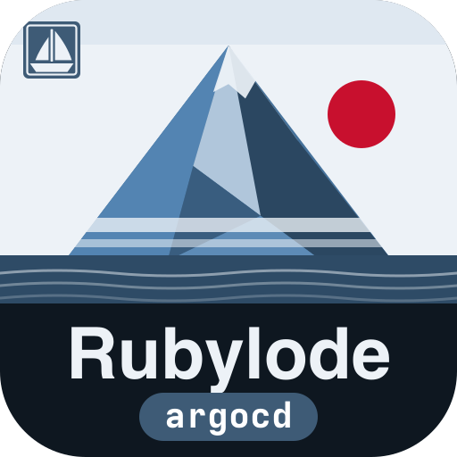
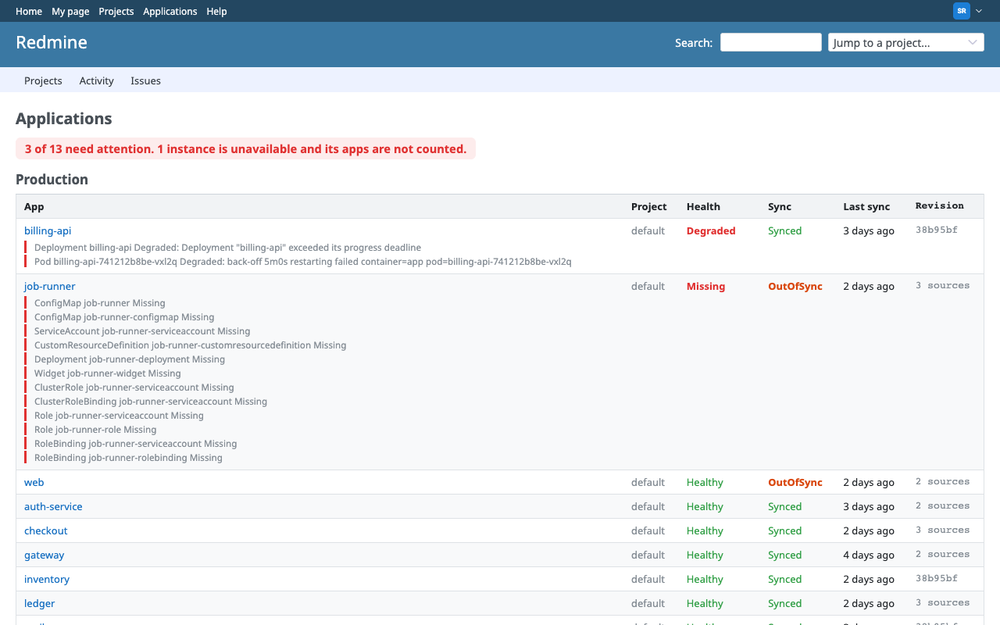
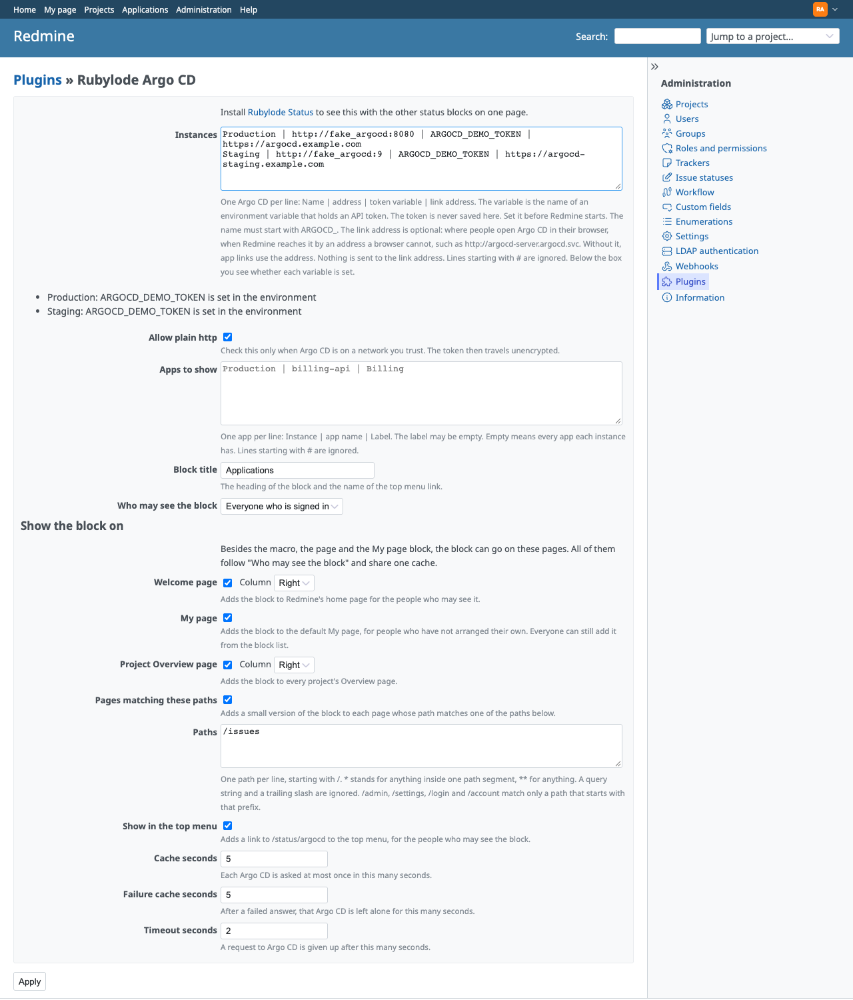
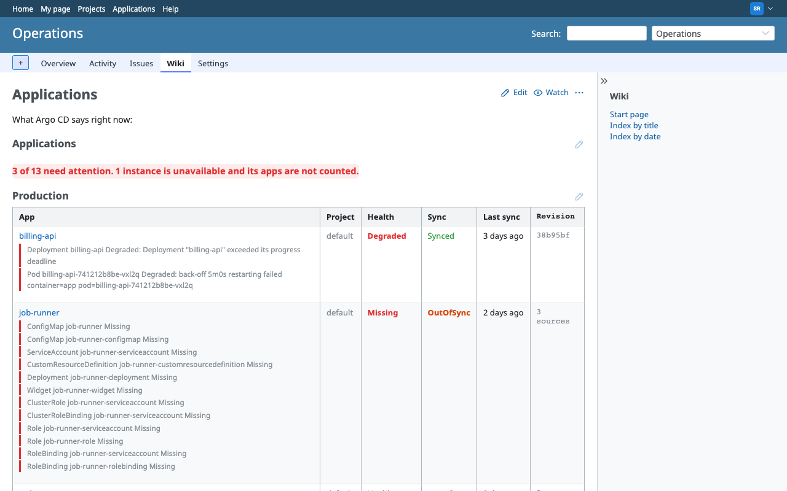

# Rubylode Argo CD for Redmine

TL;DR: this plugin shows the health and sync state of the applications one or more [Argo CD](https://argo-cd.readthedocs.io)
servers manage inside [Redmine](https://www.redmine.org): which apps are healthy, which are out of sync with git, and, for an
app in trouble, which of its resources are failing and why. It comes as a wiki macro, a page, a My page block and a partial,
and it puts its block on the [Rubylode Status](https://github.com/rubylode/redmine-rubylode-status) page when that plugin is
installed.

Each Argo CD token stays in an environment variable and the plugin only reads. Version 1.1.2, needs Redmine 5.1 or newer,
tested against Argo CD 3.6. `docs/roadmap/ROADMAP.md` lists what is not done.

Contents:

- [What it does](#what-it-does)
- [Install](#install)
- [Settings](#settings)
- [Where it shows](#where-it-shows)
- [Security](#security)
- [Troubleshooting](#troubleshooting)
- [Development](#development)
- [License](#license)

## What it does

Asks each Argo CD instance you list for its applications and shows them in one table per instance: app name (linked to the
app in the Argo CD UI), project, health, sync, when it last synced, and the revision it runs. A single-source app shows its
short revision. A multi-source app shows "3 sources", because Argo CD does not give one revision for it.

An app needs attention when its health is Degraded, Missing or Unknown, or its sync is OutOfSync. Progressing and Suspended
are shown but do not count. Apps that need attention come first, then the rest by name. A summary line says "All 12 apps
healthy and synced" or "2 of 12 need attention".

Under an app that is not Healthy the block lists the resources that are failing, each with its kind, name, health and Argo CD's
message, for example `Pod billing-api-7d9f6c-x2k4p Degraded: back-off restarting failed container`. To find them the plugin
asks Argo CD for the app's resource tree, at most 10 times per instance per refresh. Past that, the app shows what Argo CD
lists for it and the note "Detail skipped: too many apps need a look".

Instances are independent. If one cannot be reached, its table says "Status unavailable" (administrators also see why) and the
other instances and the page around them still render. An instance's answer is cached for 60 seconds by default, and for 30
after a failure.

## Install

Needs Redmine 5.1 or newer, and an Argo CD 2.x or 3.x that Redmine can reach. The plugin has no database migrations.

From the release zip:

1. Download `redmine_rubylode_argocd-1.1.2.zip` from the
   [releases page](https://github.com/rubylode/redmine-rubylode-argocd/releases). A `.sha256` file sits next to it.
2. Unpack it into Redmine's `plugins/` directory. The folder inside is already named `redmine_rubylode_argocd`.

From git:

    cd /path/to/redmine/plugins
    git clone https://github.com/rubylode/redmine-rubylode-argocd.git redmine_rubylode_argocd

Then:

1. Make a read-only Argo CD account and an API token for it (below).
2. Put the token in an environment variable where Redmine runs, then restart Redmine
   ([Passenger](https://www.phusionpassenger.com), [Puma](https://puma.io), whatever serves it).
3. In Administration, Plugins, open Rubylode Argo CD and choose Configure. Add an instance.

To remove it, delete the folder and restart. The settings stay in the database as one `plugin_redmine_rubylode_argocd`
row, which you can delete.

### A read-only Argo CD account

The plugin needs a token that can read applications and nothing else. A local account does it. In Argo CD's `argocd-cm`
config map, add an account that can only log in with an API key:

    data:
      accounts.redmine: apiKey

In `argocd-rbac-cm`, give it Argo CD's built-in read-only role:

    data:
      policy.csv: |
        g, redmine, role:readonly

or a policy of your own that grants only what the plugin reads:

    p, role:readonly-status, applications, get, */*, allow
    g, redmine, role:readonly-status

Then make the token:

    argocd account generate-token --account redmine

The token is shown once. Without a RBAC policy that lets the account read applications, Argo CD answers 403 and the block says
"Argo CD answered 403". Argo CD's documentation covers local accounts and RBAC in full (user management and RBAC
configuration); follow it if your setup differs, for example when you manage accounts with SSO or in a Helm chart.

### Put the token in Redmine's environment

The token is never typed into Redmine. Each instance names an environment variable, and the name must start with `ARGOCD_`,
for example `ARGOCD_PRODUCTION_TOKEN`. Set it where Redmine runs. With systemd, in the service's unit (`systemctl edit`):

    [Service]
    Environment=ARGOCD_PRODUCTION_TOKEN=the-token

With Docker, in the container's environment (`environment:` in Compose, or `-e ARGOCD_PRODUCTION_TOKEN` on `docker run` with the
value taken from your secret store). Restart Redmine after setting it. The settings page says whether each variable is set.

## Settings

| Setting | Default | Meaning |
|---|---|---|
| Instances | empty | One Argo CD per line: `Name | address | token variable`, with an optional fourth field, `| link address`. For example `Production | https://argocd.example.com | ARGOCD_PRODUCTION_TOKEN`. The address is where Redmine calls the API, and app links use it too unless the line has a link address (see [Redmine in the same cluster](#redmine-in-the-same-cluster)). The variable name must start with `ARGOCD_`. Lines starting with `#` are ignored. Below the box the page says whether each variable is set. |
| Allow plain http | off | See [Security](#security). |
| Apps to show | empty | One per line: `Instance | app name | Label`. The label may be empty (the app name is used). The instance must be one named in Instances. Empty: every app each instance has. |
| Cache seconds, Failure cache seconds, Timeout seconds | 60, 30, 3 | Each instance is asked at most once per cache window. After a failed answer it is left alone for the failure window. A request is given up after the timeout, with no second try. |
| Block title | Applications | The heading of the block and the name of the top menu link. |
| Who may see the block | Everyone who is signed in | Or administrators only. Anonymous visitors never see it. |
| Show the block on | all off | Welcome page, My page, Project Overview page, Pages matching these paths, and Show in the top menu. See below. |

Example instances list:

    Production | https://argocd.example.com | ARGOCD_PRODUCTION_TOKEN
    Staging | https://argocd-staging.example.com | ARGOCD_STAGING_TOKEN

### Redmine in the same cluster

When Redmine runs in the same Kubernetes cluster as Argo CD, it can call Argo CD over the in-cluster Service, for example
`http://argocd-server.argocd.svc`. No browser can resolve that name, so app links built from it go nowhere. Add the
address people open Argo CD at as a fourth field, and the links use it:

    Cluster | http://argocd-server.argocd.svc | ARGOCD_CLUSTER_TOKEN | https://argocd.example.com

Redmine still calls only the API address, and the token is never sent to the link address, so the link address may be
`http://` without "Allow plain http". The API address above is plain http and not loopback, so it needs "Allow plain
http" checked (see [Security](#security)).

Example apps list:

    Production | billing-api | Billing

The settings page checks each line when you save and names the line that is wrong.

## Where it shows

- Wiki macro: `{{argocd_status}}`, or `{{argocd_status(title=Our apps)}}`. People who may not see it get nothing where it
  stands.
- Page: `/status/argocd`.
- My page block: "Argo CD" in the list of blocks you can add to My page.
- Partial, for other plugins and themes: `render partial: "rubylode_argocd/status"` (locals `title`, `show_title` and
  `compact`).
- Rubylode Status: with that plugin installed the block also shows on its Status page, as a widget with a summary such as
  "2 need attention".

### Status page

With [Rubylode Status](https://github.com/rubylode/redmine-rubylode-status) installed, the block shows on its Status page, and
this plugin drops its own top menu item. Without it, nothing else changes and the settings page says where to get it.

### Other pages

The same block, with the same permission setting and the same cache, can be put in many places. The placements are under
"Show the block on" on the settings page.

| Where | How | Needs a setting |
|---|---|---|
| Wiki pages, news, issues, project descriptions, the welcome text | the macro `{{argocd_status}}` | no |
| My page, as a block you can move | pick "Argo CD" in the Add list | no |
| Welcome page, left or right column | check "Welcome page" | Welcome page |
| The default My page | check "My page" | My page |
| Project Overview page, left or right column | check "Project Overview page" | Project Overview page |
| Any other page, such as the issue list | check "Pages matching these paths" and list the path | Pages matching these paths |
| Its own page | open `/status/argocd` | no |
| The top menu | check "Show in the top menu" | Show in the top menu |
| A theme or another plugin | render the partial | no |

"My page" adds the block to the default My page, the one people get until they arrange their own. Everyone can still add it
from the block list.

The path list takes one pattern per line and draws a small version of the block at the top of each matching page:

    /issues
    /projects/*/issues

`*` stands for anything inside one path segment, `**` for anything including slashes. A query string and a trailing `/` are
ignored. A pattern must start with `/`. Pages under `/admin`, `/settings`, `/login` and `/account` match only a pattern that
itself starts with that prefix. A page that already shows the block is not given a second one.

For a theme or another plugin's view, the partial draws nothing for people who may not see the block:

    <%= render partial: "rubylode_argocd/status" %>
    <%= render partial: "rubylode_argocd/status", locals: { compact: true, title: "Apps", show_title: false } %>

Locals, all optional: `title` replaces the block title, `show_title: false` hides it, `compact: true` gives the small variant
without the project, last sync and revision columns.

"Show in the top menu" adds a link to `/status/argocd`, named like the block title. Only people who may see the block get it.

## Security

A token is never saved in Redmine's database, never shown on a page, never written to the log and never part of an error
message (errors name the problem, not the token). It is read from an environment variable when a request is made.

- Only `ARGOCD_...` variables are read. The settings accept a variable name only if it matches `ARGOCD_[A-Z0-9_]+`, and the
  check is made again every time a token is read. A name like `SECRET_KEY_BASE` or `DATABASE_PASSWORD` is refused when you
  save the settings, and if it is somehow in the database anyway the token counts as missing and nothing is sent. Otherwise
  an administrator could point the plugin at one of Redmine's own secrets and an address of their choosing.
- A token goes to one host. Each instance line binds a token to one address, and the token is sent only there. The
  optional link address is used only to build links in the page; Redmine never calls it. There is no
  shared list of allowed hosts. A redirect is never followed, so the token cannot be passed on to another host; the block
  says "Status unavailable" and administrators see that Argo CD redirected.
- https is required, unless the host is loopback. An `http://` address is refused when you save it, and the token is not sent
  at runtime, unless the host is `localhost`, `127.0.0.1` or `::1`, or you check "Allow plain http". Check it only when
  Argo CD is on a network you trust, for example when Redmine runs in the same cluster and reaches Argo CD over its
  in-cluster address, because anyone who can watch that traffic can read the token.
- Only administrators see why an instance is unavailable. The reason can name an address or a status code, which other
  people do not need.
- The plugin asks Argo CD only for the fields it shows, and it only sends GET requests. The account should hold only the
  read-only role above, so a leaked token cannot change anything.
- Give Redmine its own Argo CD account, so you can revoke its token without touching anyone else's access.

## Troubleshooting

- The block says "Status unavailable": administrators see the reason under it. Common ones are "No token for ..." (the
  variable is not set in Redmine's environment; the settings page says whether it is), "Argo CD answered 401" (a wrong or
  expired token), "Argo CD answered 403" (the account may not read applications), a refused plain http address, and a
  redirect.
- The block does not show: "Who may see the block" decides, and anonymous visitors never see it. With no instance set up,
  only administrators see a hint.
- An app you listed under "Apps to show" is missing: administrators see "Not found in <instance>: <apps>". Argo CD answers
  the same way for an app that does not exist and for one the account may not see.
- The top menu link is missing: with Rubylode Status installed the link is the Status plugin's.

## Development

Tests are Minitest and run in a Redmine 7 image (`docker/`), with Docker:

    bin/test                                              all unit and integration tests
    bin/test test/integration/wiki_macro_test.rb          one file

The tests run against a fake Argo CD, `test/support/fake_argocd_server.rb`. It is a small Ruby script that answers the calls
the plugin makes with the status codes and error bodies of Argo CD 3.6, from scrubbed fixtures with made-up names. It can run
on its own:

    ruby test/support/fake_argocd_server.rb

`FAKE_ARGOCD_PORT` and `FAKE_ARGOCD_TOKEN` change its port and token. The Status plugin is not in the test image, so the tests
use a stand-in for its registry.

To try the plugin by hand, `bin/demo up` starts a throwaway Redmine on http://127.0.0.1:3020 (admin / admin) next to the fake,
with two instances (the second points at a closed port, so it shows as unavailable), a person (`sam.rivera` /
`demo-password-1`) and the placements on. `bin/demo scenario NAME` switches what the fake reports (`one_degraded`,
`server_error`, `unavailable`), `bin/demo restart` picks up a change to the plugin, `bin/demo down` stops it and
`bin/demo reset` wipes it. `npm install && npm run screenshots` retakes the pictures in this README from it.

Pull Requests are welcome!

### Releasing

Push a `vX.Y.Z` tag whose version matches `version` in `init.rb` and has an entry in `CHANGELOG.md`. CI runs the tests, builds
`redmine_rubylode_argocd-X.Y.Z.zip` with a `.sha256` file and publishes the GitHub release with the changelog entry as its
notes. To build a release for a tag that already exists, use Actions, release, Run workflow.

## License

GNU General Public License, version 2 or (at your option) any later version, the same as Redmine. See `LICENSE`.

Copyright (C) 2026  Nick Gorbikoff

No warranty, as the GPL says. The plugin only reads from Argo CD, but it holds a token for it, so read the Security section and
try it on a copy of your tracker first. It is tested in CI on Redmine 7.0, 6.1, 6.0 and 5.1, against a fake Argo CD that follows
the answers of Argo CD 3.6, not against every Argo CD release.
